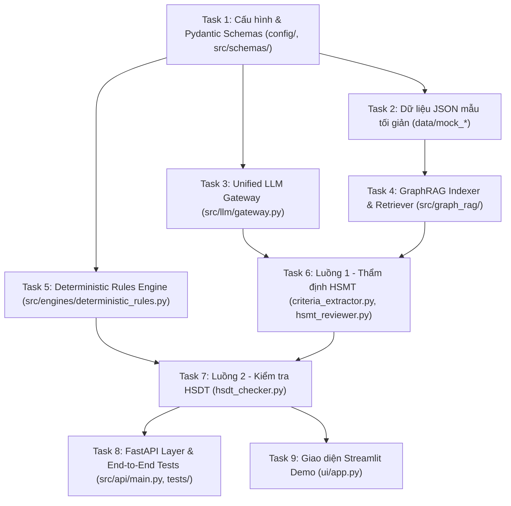

# Kế Hoạch Triển Khai Chi Tiết (Dành cho 3.8 Flash)

## 1. Tổng Quan & Các Quyết Định Kiến Trúc Đã Chốt

Tài liệu này cụ thể hóa [plan.md](file:///d:/GitHub/test-dau-thau/plan.md) thành từng Task nhỏ, rõ ràng, có tiêu chí nghiệm thu (Acceptance Criteria) và lệnh kiểm thử cụ thể để Coding Agent (3.8 Flash) thực hiện tuần tự từ đầu đến cuối mà không cần suy đoán.

### Quyết định thiết kế đã thống nhất với User:
1. **Cấu trúc thư mục gốc**: Triển khai trực tiếp tại thư mục gốc repository (`d:/GitHub/test-dau-thau/`), gồm `config/`, `data/`, `src/`, `ui/`, `tests/`, `requirements.txt`.
2. **Dữ liệu mẫu (`data/mock_*`)**: Tạo sẵn 3 file JSON mẫu tối giản (1 file cho mỗi thư mục `mock_law`, `mock_hsmt`, `mock_hsdt`) bám sát schema `ParsedDocument` để chạy `pytest` và test UI ngay lập tức. User sẽ đưa dữ liệu thật ghi đè vào sau.
3. **Cơ chế nạp tham số cho `deterministic_rules.py` (LLM Fact Extraction -> Python Math/Date Engine)**:
   - Ở bản Demo, file JSON đầu vào (`ParsedDocument`) chỉ cần đúng chuẩn hợp đồng Data cơ bản (`content_markdown`, `tables`, `visual_cues`, và `metadata` cơ bản gồm `bidding_package_name`, `bidder_name`, `submission_date`).
   - Hệ thống dùng **LLM (Structured Output)** đọc `content_markdown` / `tables` của phân đoạn liên quan để bóc tách ra các biến định lượng (`GuaranteeFacts`, `AuthorizationFacts`: ngày phát hành, ngày hết hạn, ngày đóng thầu, số tiền bảo lãnh, ngày ký ủy quyền, ngày ký đơn...) rồi truyền vào các hàm Python trong `deterministic_rules.py` để tính toán số học/ngày tháng tuyệt đối chính xác.
   - *Thiết kế mở cho Production:* Nếu sau này đội Data bóc sẵn các trường này vào `metadata` (nhờ `ConfigDict(extra="allow")`), hệ thống sẽ ưu tiên đọc từ `metadata` trước, nếu không có mới gọi LLM bóc tách.
4. **Cơ chế Embedding cho ChromaDB (`src/graph_rag/`)**: Sử dụng Default Embedding cục bộ của ChromaDB (chạy local hoàn toàn, không phụ thuộc API key khi index/search). Có cơ chế fallback an toàn nếu môi trường test không tải được model ONNX mạng ngoài.
5. **Kết nối Streamlit (`ui/app.py`) và Backend (`src/`)**: Giao diện Streamlit import và gọi trực tiếp các module trong `src/` (chỉ cần chạy 1 lệnh `streamlit run ui/app.py` là hoạt động), đồng thời vẫn hiện thực đầy đủ các REST endpoints trong `src/api/main.py` (FastAPI).
6. **Chế độ Offline/Mock LLM trong `gateway.py`**: Bên cạnh `"gemini"` và `"local"`, `gateway.py` hỗ trợ thêm chế độ `"mock"` (hoặc tự động fallback khi chưa cấu hình API key trong lúc chạy `pytest`) để toàn bộ pipeline và unit tests luôn chạy xanh 100% độc lập.

---

## 2. Sơ Đồ Phụ Thuộc (Dependency Graph)

---

## 3. Chi Tiết Từng Task Cho 3.8 Flash

### Task 1: Thiết lập Môi trường, Cấu hình & Pydantic Schemas
**Mô tả:** Tạo `requirements.txt`, cấu hình `config/settings.py`, `config/prompts.yaml` và 3 file Pydantic Schema chuẩn trong `src/schemas/`.

**Files cần tạo/sửa:**
- `requirements.txt`
- `config/__init__.py`
- `config/settings.py`
- `config/prompts.yaml`
- `src/__init__.py`
- `src/schemas/__init__.py`
- `src/schemas/document.py`
- `src/schemas/criteria.py`
- `src/schemas/report.py`

**Yêu cầu kỹ thuật chi tiết:**
1. `src/schemas/document.py`:
   - `DocRole(str, Enum)`: `LAW`, `HSMT`, `HSDT`.
   - `DocCategory(str, Enum)`: `TONG_HOP`, `DON_DU_THAU`, `BAO_LANH_DU_THAU`, `THOA_THUAN_LIEN_DANH`, `GIAY_UY_QUYEN`, `DANG_KY_KINH_DOANH`, `BAO_CAO_TAI_CHINH`, `HOP_DONG_TUONG_TU`, `NHAN_SU_CHU_CHOT`, `KHAC`.
   - `TableItem(BaseModel)`: `table_id: str`, `page_number: int`, `caption: Optional[str] = None`, `markdown_table: str`.
   - `VisualCues(BaseModel)`: `has_signature: bool = False`, `has_red_stamp: bool = False`, `stamp_text_ocr: Optional[str] = None`, `page_numbers: List[int] = Field(default_factory=list)`.
   - `DocumentSection(BaseModel)`: `section_id: str`, `parent_id: Optional[str] = None`, `heading: str`, `page_start: int`, `page_end: int`, `content_markdown: str`, `tables: List[TableItem] = Field(default_factory=list)`, `visual_cues: Optional[VisualCues] = None`.
   - `DocumentMetadata(BaseModel)`: Dùng `model_config = ConfigDict(extra="allow")`. Khai báo các trường chuẩn trong hợp đồng Data:
     - `bidding_package_name: Optional[str] = None`
     - `bidder_name: Optional[str] = None`
     - `submission_date: Optional[str] = None`
   - `ParsedDocument(BaseModel)`: `doc_id: str`, `doc_role: DocRole`, `doc_category: Optional[DocCategory] = DocCategory.TONG_HOP`, `file_name: str`, `total_pages: int`, `metadata: DocumentMetadata = Field(default_factory=DocumentMetadata)`, `sections: List[DocumentSection]`.
   - **Bổ sung các Schema trung gian để LLM bóc tách dữ liệu định lượng từ văn bản (`Fact Extraction Schemas`)** trong `src/schemas/document.py` (hoặc `src/schemas/criteria.py`):
     - `ExtractedGuaranteeFacts(BaseModel)`:
       - `issue_date: Optional[str] = Field(None, description="Ngày phát hành bảo lãnh định dạng YYYY-MM-DD")`
       - `expiry_date: Optional[str] = Field(None, description="Ngày hết hạn bảo lãnh định dạng YYYY-MM-DD")`
       - `bid_close_date: Optional[str] = Field(None, description="Ngày đóng thầu định dạng YYYY-MM-DD")`
       - `validity_days_mentioned: Optional[int] = Field(None, description="Số ngày hiệu lực ghi trong văn bản nếu có")`
       - `actual_amount: Optional[float] = Field(None, description="Số tiền bảo lãnh thực tế (VNĐ)")`
     - `ExtractedAuthFacts(BaseModel)`:
       - `auth_date: Optional[str] = Field(None, description="Ngày ký giấy ủy quyền định dạng YYYY-MM-DD")`
       - `auth_expiry_date: Optional[str] = Field(None, description="Ngày hết hạn ủy quyền định dạng YYYY-MM-DD nếu có")`
       - `bid_sign_date: Optional[str] = Field(None, description="Ngày ký đơn dự thầu định dạng YYYY-MM-DD")`
       - `bid_close_date: Optional[str] = Field(None, description="Ngày đóng thầu định dạng YYYY-MM-DD")`
2. `src/schemas/criteria.py`:
   - `CriterionCategory(str, Enum)`: `TU_CACH_HOP_LE`, `DON_DU_THAU`, `BAO_LANH_DU_THAU`, `UY_QUYEN`, `NANG_LUC_TAI_CHINH`, `KINH_NGHIEM_DU_AN`, `KHAC`.
   - `EvaluationCriterion(BaseModel)`: `criterion_id: str`, `criterion_name: str`, `category: CriterionCategory`, `requirement_summary: str`, `source_section_id: Optional[str] = None`, `page_number: Optional[int] = None`, `extracted_quote: Optional[str] = None`, `max_legal_rate_percent: Optional[float] = None`, `configured_rate_percent: Optional[float] = None`, `required_days: Optional[int] = None`, `required_amount: Optional[float] = None`.
   - `CriteriaList(BaseModel)`: `package_name: str`, `criteria: List[EvaluationCriterion]`.
3. `src/schemas/report.py`: Giữ đúng 100% các class trong Mục 4 của `plan.md` (`ComplianceStatus`, `EvidenceItem`, `LegalReference`, `CriterionAssessment`, `VerificationReport`).

**Acceptance Criteria & Verification:**
- [ ] Import thành công toàn bộ schemas và settings bằng lệnh `python -c "from src.schemas.document import ParsedDocument; from src.schemas.criteria import CriteriaList; from src.schemas.report import VerificationReport; print('OK')"`.

---

### Task 2: Khởi tạo Bộ Dữ liệu JSON Mẫu Tối giản (`data/mock_*`)
**Mô tả:** Tạo 3 file JSON mẫu tuân thủ chặt chẽ `ParsedDocument` để phục vụ phát triển và kiểm thử tự động trước khi User nạp dữ liệu thật.

**Files cần tạo:**
- `data/mock_law/land_bidding_laws.json` (1 văn bản hoặc danh sách văn bản `ParsedDocument` có `doc_role="LAW"`, chứa Điều 14 về Bảo lãnh dự thầu từ 1% - 3% tổng mức đầu tư, Điều 18 về Hiệu lực bảo lãnh và Giấy ủy quyền hợp lệ có chữ ký & con dấu đỏ, có câu dẫn chiếu *"theo quy định tại Điều 14"* để test cạnh `REFERENCES`).
- `data/mock_hsmt/hsmt_sample.json` (`doc_role="HSMT"`, gói thầu Khu đô thị mới Bắc Sông Hồng, cài 1 tiêu chí Bảo lãnh dự thầu yêu cầu 5% tổng mức đầu tư — vượt trần 3% của Luật; cùng các tiêu chí Hiệu lực bảo lãnh >= 120 ngày và Giấy ủy quyền đại diện hợp pháp).
- `data/mock_hsdt/hsdt_sample.json` (`doc_role="HSDT"`, nhà thầu Công ty CP Đầu tư Xây dựng Sao Việt, chỉ dùng `metadata` cơ bản theo đúng hợp đồng Data, còn toàn bộ ngày tháng/số tiền nằm tự nhiên trong `content_markdown` và `tables` của các section để LLM tự trích xuất và kiểm thử đủ 3 trạng thái:
  1. Tư cách hợp lệ & Đơn dự thầu (ký ngày `2026-05-10`, đóng thầu `2026-05-15`) -> `HOP_LE`
  2. Bảo lãnh dự thầu ghi trong văn bản: phát hành ngày `2026-05-10`, có hiệu lực đến ngày `2026-08-08` (tức chỉ 85 ngày tính từ ngày đóng thầu `2026-05-15`, nhỏ hơn mức 120 ngày yêu cầu trong HSMT) -> `KHONG_HOP_LE`
  3. Giấy ủy quyền có `has_signature=True`, `has_red_stamp=True` nhưng `stamp_text_ocr=""` (bị mờ con dấu) -> `CHUA_DU_CAN_CU`).

**Acceptance Criteria & Verification:**
- [ ] Validate cả 3 file JSON qua `ParsedDocument.model_validate_json(...)` không báo lỗi.

---

### Task 3: Xây dựng Unified LLM Gateway (`src/llm/gateway.py`)
**Mô tả:** Xây dựng lớp giao tiếp thống nhất với Google Gemini API, Local OpenAI-compatible API, và chế độ Fallback/Mock cho môi trường không có API key.

**Files cần tạo:**
- `src/llm/__init__.py`
- `src/llm/gateway.py`

**Yêu cầu kỹ thuật chi tiết:**
- Hàm chính: `generate_structured_output(prompt: str, response_model: Type[T], provider: Optional[str] = None, system_instruction: Optional[str] = None, **kwargs) -> T`.
- Khi `provider == "gemini"`:
  - Sử dụng `from google import genai` và `from google.genai import types`.
  - Gọi `client.models.generate_content(model=model_name, contents=prompt, config=types.GenerateContentConfig(system_instruction=system_instruction, response_mime_type="application/json", response_schema=response_model, temperature=0.1))`.
  - Parse kết quả về `response_model.model_validate_json(response.text)`.
- Khi `provider == "local"`:
  - Sử dụng `from openai import OpenAI`.
  - Gắn JSON schema của `response_model.model_json_schema()` vào system prompt hoặc `response_format={"type": "json_object"}` và parse qua `response_model.model_validate_json(...)`.
- Khi `provider == "mock"` (hoặc khi `provider` không có API key và bật cờ `allow_mock_fallback=True`):
  - Sinh dữ liệu có cấu trúc dựa trên ngữ cảnh prompt & `response_model` để phục vụ chạy test offline hoặc demo không cần key.

**Acceptance Criteria & Verification:**
- [ ] Chạy test gọi `generate_structured_output` với `provider="mock"` trả về đúng instance của Pydantic model.

---

### Task 4: Xây dựng GraphRAG cho Tri thức Pháp luật (`src/graph_rag/`)
**Mô tả:** Hiện thực hóa bộ lập chỉ mục đồ thị + vector (`indexer.py`) và bộ truy xuất lai (`retriever.py`).

**Files cần tạo:**
- `src/graph_rag/__init__.py`
- `src/graph_rag/indexer.py`
- `src/graph_rag/retriever.py`

**Yêu cầu kỹ thuật chi tiết:**
1. `indexer.py`:
   - Hàm `build_law_index(law_dir: str = "data/mock_law", storage_dir: str = "data/storage") -> dict`:
   - Đọc tất cả file `.json` trong `law_dir` theo schema `ParsedDocument` (hỗ trợ cả file chứa 1 object `ParsedDocument` hoặc 1 list `List[ParsedDocument]`).
   - Với mỗi `section` trong văn bản Luật:
     - Tạo node trong `networkx.DiGraph`: `node_id = f"{doc.doc_id}::{section.section_id}"`, lưu thuộc tính `doc_id`, `file_name`, `section_id`, `heading`, `page_start`, `page_end`, `content_markdown`.
     - Thêm cạnh `PART_OF` hoặc phân cấp nếu có `parent_id`.
     - Dùng Regex tìm các tham chiếu chéo trong `content_markdown` (ví dụ: `r"(?:Điều|Khoản|Mục)\s+(\d+[a-zA-Z0-9\.]*)"`) và tạo cạnh `REFERENCES` nối tới section có `heading` hoặc `section_id` khớp.
   - Lưu đồ thị ra `data/storage/law_graph.json` bằng `nx.node_link_data(G)`.
   - Lưu các section vào `chromadb.PersistentClient(path="data/storage/chroma_db")` (collection `"legal_articles"`) sử dụng Default Embedding của ChromaDB (kèm fallback lưu JSON index nếu môi trường thiếu thư viện ONNX).
2. `retriever.py`:
   - Hàm `retrieve_legal_context(query: str, top_k: int = 3, hop_depth: int = 1, storage_dir: str = "data/storage") -> List[dict]`:
   - Bước 1: Query ChromaDB lấy `top_k` điều khoản gần nhất.
   - Bước 2: Load `law_graph.json` vào `nx.node_link_graph`, từ các node tìm được ở Bước 1 duyệt các cạnh `REFERENCES` (cả chiều đi và chiều đến trong phạm vi `hop_depth`) để lấy thêm các điều khoản liên quan trực tiếp.
   - Bước 3: Trả về danh sách các dict chứa `node_id`, `law_name`, `clause_id` (`heading`), `content_markdown`, `page_number`, `relation_type` (`"DIRECT_MATCH"` hoặc `"GRAPH_HOP"`).

**Acceptance Criteria & Verification:**
- [ ] Chạy `build_law_index()` tạo ra file `data/storage/law_graph.json` và thư mục ChromaDB.
- [ ] Gọi `retrieve_legal_context("bảo lãnh dự thầu")` trả về được cả điều khoản khớp trực tiếp và điều khoản dẫn chiếu qua 1 hop.

---

### Task 5: Xây dựng Deterministic Rules Engine (`src/engines/deterministic_rules.py`)
**Mô tả:** Hiện thực các hàm kiểm tra toán học, ngày tháng và cờ xác thực vật lý (chữ ký/con dấu) tuyệt đối chính xác bằng Python thuần.

**Files cần tạo:**
- `src/engines/__init__.py`
- `src/engines/deterministic_rules.py`

**Yêu cầu kỹ thuật chi tiết:**
1. `check_guarantee_validity(issue_date: Optional[str], expiry_date: Optional[str], bid_close_date: Optional[str], required_days: Optional[int], required_amount: Optional[float], actual_amount: Optional[float]) -> dict`:
   - Parse ngày định dạng `YYYY-MM-DD` (hoặc `DD/MM/YYYY`).
   - Kiểm tra:
     - `issue_date <= bid_close_date` (Bảo lãnh phải phát hành trước hoặc cùng thời điểm đóng thầu).
     - Số ngày hiệu lực `(expiry_date - bid_close_date).days >= required_days`.
     - Giá trị bảo lãnh `actual_amount >= required_amount`.
   - Nếu thiếu thông tin đầu vào (`None`), trả về `status = ComplianceStatus.INSUFFICIENT_BASIS`.
   - Trả về dict gồm: `status`, `passed: bool`, `validity_days: Optional[int]`, `amount_diff: Optional[float]`, `violations: List[str]`, `details: str`.
2. `check_authorization_dates(auth_date: Optional[str], bid_sign_date: Optional[str], bid_close_date: Optional[str]) -> dict`:
   - Kiểm tra `auth_date <= bid_sign_date <= bid_close_date` (Giấy ủy quyền phải có hiệu lực trước hoặc trong ngày ký đơn dự thầu và trước thời điểm đóng thầu).
   - Trả về dict gồm: `status`, `passed: bool`, `violations: List[str]`, `details: str`.
3. `verify_visual_stamps(visual_cues: Optional[VisualCues]) -> dict`:
   - Nếu `visual_cues is None`: trả về `INSUFFICIENT_BASIS`.
   - Nếu `not visual_cues.has_signature` hoặc `not visual_cues.has_red_stamp`: trả về `INVALID` (Thiếu chữ ký hoặc con dấu đỏ).
   - Nếu có chữ ký và con dấu đỏ nhưng `stamp_text_ocr` rỗng hoặc chứa từ khóa mờ/không đọc được (`"mờ"`, `"không rõ"`, `""`): trả về `INSUFFICIENT_BASIS` kèm ghi chú cần làm rõ/đối chiếu bản gốc.
   - Ngược lại trả về `VALID`.

**Acceptance Criteria & Verification:**
- [ ] Unit test cho cả 3 hàm với các trường hợp hợp lệ, vi phạm, và thiếu dữ liệu/mờ con dấu.

---

### Task 6: Luồng 1 — Thẩm định HSMT (`criteria_extractor.py` & `hsmt_reviewer.py`)
**Mô tả:** Bóc tách danh mục tiêu chí từ HSMT và đối chiếu từng tiêu chí với GraphRAG Luật để phát hiện các quy định trái luật (như nâng trần bảo lãnh dự thầu vượt mức quy định).

**Files cần tạo:**
- `src/engines/criteria_extractor.py`
- `src/engines/hsmt_reviewer.py`

**Yêu cầu kỹ thuật chi tiết:**
1. `criteria_extractor.py`:
   - Hàm `extract_criteria_from_hsmt(hsmt_doc: ParsedDocument, provider: str = "gemini", **llm_kwargs) -> CriteriaList`:
   - Tổng hợp các section của `hsmt_doc` và `metadata`, gọi LLM Gateway (hoặc rule-assisted extraction + LLM) để trả về `CriteriaList` thuộc các nhóm: Tư cách hợp lệ, Đơn dự thầu, Bảo lãnh dự thầu, Ủy quyền, Năng lực tài chính, Kinh nghiệm dự án tương tự.
2. `hsmt_reviewer.py`:
   - Hàm `review_hsmt(hsmt_doc: ParsedDocument, provider: str = "gemini", **llm_kwargs) -> tuple[CriteriaList, VerificationReport]`:
   - Bước 1: Gọi `extract_criteria_from_hsmt`.
   - Bước 2: Với mỗi `EvaluationCriterion`:
     - Truy vấn `retrieve_legal_context` từ GraphRAG.
     - Kiểm tra định lượng nếu là tiêu chí Bảo lãnh dự thầu (ví dụ: tỷ lệ bảo lãnh trong HSMT > 3% theo Luật Đấu thầu -> đánh dấu `KHONG_HOP_LE`).
     - Gọi LLM Gateway để tổng hợp lập luận pháp lý (`CriterionAssessment`) kèm `EvidenceItem` (số trang, trích dẫn nguyên văn từ HSMT) và `LegalReference` (từ GraphRAG).
   - Bước 3: Đóng gói và trả về `(criteria_list, VerificationReport)` với `workflow_type="THAM_DINH_HSMT"`.

**Acceptance Criteria & Verification:**
- [ ] Chạy `review_hsmt` trên `data/mock_hsmt/hsmt_sample.json` phát hiện chính xác tiêu chí Bảo lãnh dự thầu 5% là `KHONG_HOP_LE` (vượt trần Luật quy định).

---

### Task 7: Luồng 2 — Kiểm tra HSDT (`src/engines/hsdt_checker.py`)
**Mô tả:** Đối chiếu Hồ sơ dự thầu (`ParsedDocument`) với Bộ tiêu chí HSMT (`CriteriaList`), kết hợp `deterministic_rules.py`, `GraphRAG` và `LLM Gateway`.

**Files cần tạo:**
- `src/engines/hsdt_checker.py`

**Yêu cầu kỹ thuật chi tiết:**
- Hàm `check_hsdt(hsdt_doc: ParsedDocument, criteria_list: CriteriaList, hsmt_doc: Optional[ParsedDocument] = None, provider: str = "gemini", **llm_kwargs) -> VerificationReport`:
- Với mỗi tiêu chí trong `criteria_list.criteria`:
  1. Tìm các `DocumentSection` liên quan trong `hsdt_doc` (dựa trên từ khóa tiêu đề/nội dung và danh mục).
  2. **Bước Trích xuất Biến Định lượng (LLM Fact Extraction) + Kiểm tra Toán học (`deterministic_rules.py`)**:
     - Nếu `category == BAO_LANH_DU_THAU`:
       - Gọi LLM Gateway (`response_model=ExtractedGuaranteeFacts`) để bóc `issue_date`, `expiry_date`, `bid_close_date`, `actual_amount` từ `content_markdown` / `tables` của section Bảo lãnh và Đơn dự thầu (nếu trong `metadata` có sẵn thì ưu tiên lấy từ `metadata`).
       - Truyền các biến vừa bóc vào `check_guarantee_validity(...)` và chạy `verify_visual_stamps(section.visual_cues)`.
     - Nếu `category == UY_QUYEN`:
       - Gọi LLM Gateway (`response_model=ExtractedAuthFacts`) để bóc `auth_date`, `bid_sign_date`, `bid_close_date` từ `content_markdown` của section Giấy ủy quyền và Đơn dự thầu (hoặc từ `metadata` nếu có).
       - Truyền vào `check_authorization_dates(...)` và chạy `verify_visual_stamps(section.visual_cues)`.
     - Các mục khác: chạy `verify_visual_stamps(section.visual_cues)` nếu section có thông tin `visual_cues`.
  3. Lấy căn cứ pháp lý từ `retrieve_legal_context`.
  4. Đưa bằng chứng (`EvidenceItem`), kết quả tính toán từ `deterministic_rules`, và `LegalReference` qua LLM Gateway để sinh `CriterionAssessment` (ưu tiên giữ trạng thái `KHONG_HOP_LE` hoặc `CHUA_DU_CAN_CU` từ `deterministic_rules` để đảm bảo tính chặt chẽ số học/vật lý).
- Tổng hợp số lượng `valid_count`, `invalid_count`, `insufficient_count` và trả về `VerificationReport(workflow_type="KIEM_TRA_HSDT", ...)`.

**Acceptance Criteria & Verification:**
- [ ] Chạy `check_hsdt` trên `data/mock_hsdt/hsdt_sample.json` trả về `VerificationReport` có đủ 3 trạng thái: `HOP_LE` (Tư cách hợp lệ/Đơn dự thầu), `KHONG_HOP_LE` (Bảo lãnh thiếu ngày hiệu lực), và `CHUA_DU_CAN_CU` (Ủy quyền bị mờ con dấu).

---

### Task 8: FastAPI Layer (`src/api/main.py`) & Bộ Kiểm thử Tổng thể (`tests/test_workflows.py`)
**Mô tả:** Xây dựng các REST API endpoints bằng FastAPI và viết bộ kiểm thử tự động kiểm tra toàn bộ luồng từ đầu đến cuối.

**Files cần tạo:**
- `src/api/__init__.py`
- `src/api/main.py`
- `tests/__init__.py`
- `tests/test_workflows.py`

**Yêu cầu kỹ thuật chi tiết:**
1. `src/api/main.py`:
   - `GET /health`: Kiểm tra trạng thái server.
   - `POST /api/v1/graph/reindex`: Chạy `build_law_index()`.
   - `POST /api/v1/hsmt/review`: Nhận `ParsedDocument` của HSMT và cấu hình LLM, trả về `CriteriaList` + `VerificationReport`.
   - `POST /api/v1/hsdt/check`: Nhận `ParsedDocument` của HSDT + `CriteriaList` (hoặc HSMT), trả về `VerificationReport`.
2. `tests/test_workflows.py`:
   - Test validate schemas & mock JSON files.
   - Test `deterministic_rules.py` (Bảo lãnh, Ủy quyền, Con dấu).
   - Test `GraphRAG` index & retrieve.
   - Test Luồng 1 (`review_hsmt`) và Luồng 2 (`check_hsdt`).
   - Test FastAPI endpoints qua `fastapi.testclient.TestClient`.

**Acceptance Criteria & Verification:**
- [ ] Lệnh `pytest tests/test_workflows.py -v` pass 100% các test cases.

---

### Task 9: Giao diện Demo Streamlit (`ui/app.py`) & Cập nhật `README.md`
**Mô tả:** Xây dựng giao diện người dùng trực quan trên Streamlit (gọi trực tiếp các module trong `src/`) và tài liệu hướng dẫn chạy hệ thống.

**Files cần tạo/sửa:**
- `ui/app.py`
- `README.md`

**Yêu cầu kỹ thuật chi tiết cho `ui/app.py`:**
- **Sidebar:**
  - Chọn LLM Provider (`gemini`, `local`, hoặc `mock` để demo nhanh không cần key).
  - Ô nhập `Gemini API Key` / `Model Name` hoặc `Local LLM Base URL` / `Model Name`.
  - Nút **"Re-index GraphRAG Luật"**: Gọi `build_law_index()` và hiển thị số lượng điều khoản & cạnh tham chiếu đã nạp.
- **Tab 1: Thẩm định HSMT (Online Flow 1):**
  - Cho phép chọn "Dùng file mẫu (`hsmt_sample.json`)" hoặc Upload file JSON theo schema `ParsedDocument`.
  - Nút **"Chạy Thẩm Định HSMT"**.
  - Hiển thị Metrics tổng quan (`Tổng tiêu chí`, `Hợp lệ`, `Trái luật/Hạn chế`, `Chưa đủ căn cứ`).
  - Hiển thị bảng **Danh mục Tiêu chí bóc tách** và danh sách chi tiết cảnh báo các điểm bất hợp lý so với Luật (kèm số trang trích dẫn và điều khoản Luật dẫn chiếu).
  - Lưu `criteria_list` vào `st.session_state` để chuyển sang dùng ở Tab 2.
- **Tab 2: Kiểm tra HSDT (Online Flow 2):**
  - Cho phép chọn "Dùng file mẫu (`hsdt_sample.json`)" hoặc Upload file JSON HSDT.
  - Nút **"Chạy Kiểm Tra HSDT"**.
  - Hiển thị **Bảng Ma trận Tuân thủ (Compliance Matrix)** với màu sắc trực quan (`HOP_LE` - Xanh, `KHONG_HOP_LE` - Đỏ, `CHUA_DU_CAN_CU` - Vàng).
  - Với từng tiêu chí, cho phép mở rộng (expander) xem:
    - Trích dẫn nguyên văn & số trang gốc (`EvidenceItem`) + Ghi chú kiểm tra chữ ký/con dấu đỏ (`visual_check_note`).
    - Căn cứ pháp lý (`LegalReference`).
    - Lập luận phân tích (`reasoning`).
    - Điểm mâu thuẫn/thiếu căn cứ (`missing_or_unclear_points`) và **Đề xuất nội dung gửi nhà thầu làm rõ (`recommendation`)**.

**Acceptance Criteria & Verification:**
- [ ] Kiểm tra cú pháp và import của `ui/app.py` không có lỗi.
- [ ] Chạy lại toàn bộ `pytest` xanh 100%.
